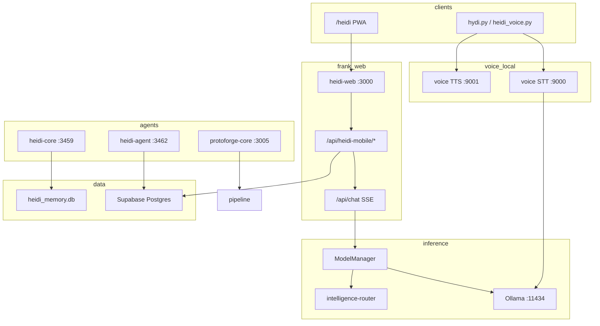

# HYDI architecture map (reconciliation)

**Baseline SHA:** `06cf644d7325ac8b4488913253de54e02b57fb30`  
**Rule:** extend existing modules — no second orchestrator, no parallel memory DB.

---

## Dependency graph (simplified)

---

## Orchestration ownership (avoid duplicates)

| Concern | Canonical module | Do not duplicate |
|---------|------------------|------------------|
| Chat / tool agent | `pages/api/chat.ts`, `lib/ModelManager.ts` | New chat routers |
| Work sessions | `lib/orchestrator` (`HeidiOrchestrator`) | Second session runner |
| Heidi missions | `heidi-core/missions/`, worker | Ad-hoc exec queues |
| Execution fabric | `lib/execution-fabric/gateway.js` | Parallel job stores |
| Persistent agent loop | `heidi-core/heidi-agent.js`, `lib/heidi/agent-persistent-loop.js` | Extra daemons on new ports |
| Mobile control plane | `pages/api/heidi-mobile/*`, `lib/heidi-mobile/hydiClient.js` | Client-side secrets |
| Voice I/O | `services/voice/`, `src/hydi-v3/*Adapter.js`, `heidi_voice.py` | Cloud STT/TTS APIs |
| Memory (chat turns) | `heidi-core/memory/` (SQLite) | New chat DB |
| Memory (facts/RAG) | Supabase `hydi_facts`, embeddings | Second vector index without migration |
| Self-improvement | `lib/heidi/bounded-self-improvement-loop.js` | Scheduled unattended refactors |

---

## Reuse / extend / missing matrix

| Capability | Exists | Extend | Missing / gap |
|------------|--------|--------|----------------|
| Local Ollama | Yes (`ModelManager`, env) | Health probes, routing prefs | Frank concurrent model budget unknown |
| Cloud LLM | Yes (gated) | Capability registry, cost/latency metrics | Live creds + policy on Frank unverified |
| Task routing | Partial (`intelligence-router`, NCM) | Wire into `ModelManager` consistently | Privacy-aware routes not unified |
| Context across providers | Partial (session memory) | Session IDs + mission context | No single cross-provider transcript store |
| Embeddings 768 | Migration merged | Run `backfill-embeddings.js --apply` on Frank | DB acceptance not done |
| Agent :3462 | Code + PM2 entry | Observe via phone fleet card | Live lease/bounds row unverified |
| Voice services | Python apps | PM2 wrappers, firewall, `VOICE_BIND` | Not in `ecosystem.config.js` |
| V3 voice router | Adapters + safety | Connect to `VoiceInterface` consumers | No production caller wired |
| Mobile approvals | Client inline cards | BFF `missionId` on SSE `actions` | Server emission gap |
| Execution lifecycle | Fabric + missions | Evidence on verify step | End-to-end acceptance on Frank |
| Evolution 2.0 | Supervisor + bounded loop | OBSERVE→…→VERIFY checklist | No auto-PR without human |
| Revenue slice | Revenue engine, Stripe | One vertical LEAD→PAY proof | Earned vs projected separation |

---

## Competing / dead integrations flagged

| Finding | Severity | Action |
|---------|----------|--------|
| Two `ModelManager` concepts (`lib/ModelManager.ts` vs `src/hydi-v3/ModelManager.js`) | Medium | Document import paths; route V3 through bridge |
| Voice stack not PM2-supervised | High | Add optional `heidi-voice-stt/tts` apps or document manual start |
| Chat `actions.missionId` client-only | Medium | Align BFF chat stream with SHARED CONTRACT |
| NCM inference optional silo | Low | Keep off until RAM budget approved |
| `hydi.py` Groq path vs local-first policy | Low | Ensure phone paths prefer Frank Ollama ($0) |