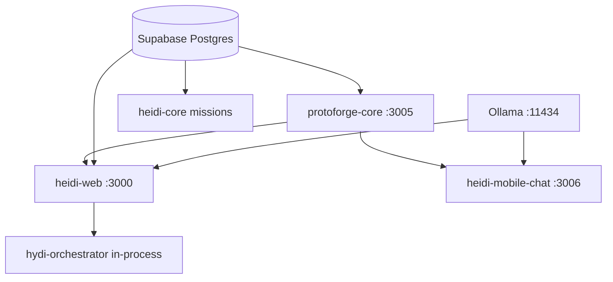

# SYSTEM_DEPENDENCY_MAP

**Commit:** `855141a4`  
**Authority:** `boot.config.json`, `ecosystem.config.js`, `CLAUDE.md`

## Boot order (Frank / full stack)

| Module | Port | Depends on | Health |
|--------|------|------------|--------|
| protoforge-core | 3005 | — | `GET /health` |
| heidi-web | 3000 | protoforge-core | `GET /api/health` |
| heidi-mobile-chat | 3006 | heidi-web (BFF) | PM2 on Frank |
| heidi-core | (varies) | Postgres, sqlite memory | missions API |
| hydi-daemon | file status | Postgres + Supabase REST | `.heidi-daemon-status.json` |
| Supabase | 54321 REST / 54322 PG | Docker | `supabase status` |
| Ursula suite | 5000 | Python venv | separate repo path on Frank |

## Data / control planes

| Plane | Stores | Consumers |
|-------|--------|-----------|
| RAW event ledger | Supabase | CASCADE → KILO → ProtoForge |
| Heidi missions | Postgres + `mission_events` | mission-worker, mobile tasks |
| Heidi memory | `heidi_memory.db` | chat, `/chat-tools` |
| Frank observation | `.runtime/*`, `.observatory/` | frank-observer, phone `/api/phone/observe` |
| Production truth | `.runtime/production-truth/*.json` | frank-truth-loader, Evolution proofs |
| Revenue (legacy Connect) | `financial_ledger`, Stripe | checkout webhooks |
| Revenue (billing module) | `billing_*` tables | `pages/api/billing/*`, billing-worker |
| Human actions | `data/human-actions.json` + mirror | resolver, approvals |

## External dependencies

| Dependency | Required for | Cloud VM |
|------------|--------------|----------|
| Docker + Supabase | DB-backed tests, health | **down** |
| Stripe test keys | Checkout, billing sandbox | **missing** |
| Tailscale | Frank MCP, real mobile backend | **not joined** |
| Ollama | $0 inference | **not running** (Frank) |