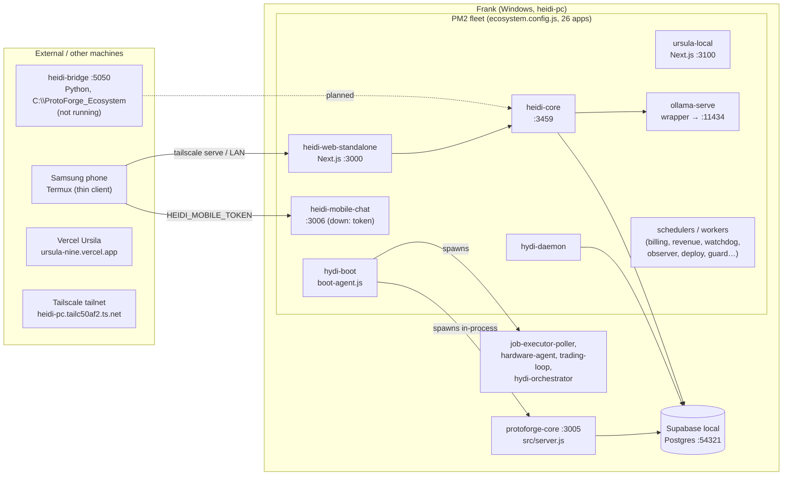

# HYDI / ProtoForge — System Architecture (Phase 0 ground truth)

Verified against the live PM2 fleet and listening ports on Frank
(`heidi-pc`, `C:\Users\Owner\HYDI-System-v2`, branch `clean-main`)
on 2026-11-07. See `docs/DISCREPANCIES.md` for where owner notes differ.

## Topology

## Services

### PM2-managed (all `cwd = C:\Users\Owner\HYDI-System-v2` unless noted)

| PM2 name | Script / entry | Port | Role | Start |
|---|---|---|---|---|
| hydi-boot | `scripts/boot-agent.js` | — | Authoritative boot: preflight + module orchestration | PM2 |
| hydi-daemon | `scripts/heidi-daemon-launcher.js` | — | Cognitive loop; writes `.heidi-daemon-status.json` | PM2 |
| heidi-core | `heidi-core/server.js` | 3459 | Missions, approvals, chat-tools, memory, ops agent | PM2 |
| heidi-web-standalone | `next start` (.next build) | 3000 | Dashboard + `/heidi` PWA + `/api/*` | PM2 |
| heidi-mobile-chat | `launch-heidi-mobile.js` | 3006 | Phone chat BFF | PM2 (waiting restart — `HEIDI_MOBILE_TOKEN` unset) |
| ursula-local | `apps/ursula-frontend` `next start` | 3100 | Ursula command center | PM2 |
| rezonate-app | `protoforge-applications/rezonate/src/index.js` | 3001 | Rezonate app | PM2 |
| ollama-serve | `scripts/ollama-serve.js` → `ollama serve` | 11434 | Local LLM, memory-bounded | PM2 |
| hydi-watchdog, hydi-system-health, hydi-schedulers, hydi-protoforge-scout, hydi-stuck-job-scheduler, hydi-revenue-reconciliation, hydi-failed-webhook-retry, hydi-billing-worker, hydi-model-prep-executor, hydi-revenue-autopilot-tick, hydi-stripe-webhook-listener, hydi-daily-loop, hydi-local-ci, hydi-public-tunnel (ngrok) | `scripts/*` | — | Scheduled jobs, workers, tunnel | PM2 |
| heidi-agent | `heidi-core/heidi-agent.js` | 3461 (advisory only) | Advisory agent | PM2 |
| frank-observer / frank-auto-deploy / frank-storage-guard | `scripts/frank-*.js` | — | Read-only observability, auto-deploy, disk guard | PM2 |
| pm2-logrotate | module | — | Log rotation | PM2 module |

### Spawned by hydi-boot (in-process children, not separate PM2 rows)

| Module | Command | Port | Notes |
|---|---|---|---|
| protoforge-core | `node src/server.js` | 3005 | CASCADE/KILO/ProtoForge + agent bus |
| job-executor-poller | `npx tsx scripts/job-executor-poller.ts` | — | Job queue poller |
| hardware-agent | `python agents/hardware-controller/safety_orchestrator.py` | — | HID hardware |
| trading-loop | `python hydi_scripts/trading_loop.py` | — | Trading loop |
| hydi-orchestrator | module (in boot-agent) | — | In-process |
| heidi-web / heidi-mobile-chat / ursula-local / rezonate-app / revenue-autopilot-tick | delegated to PM2 (`supervisor: "pm2"`) | — | boot-agent does not double-start these |

### External to this repo / PM2

| Service | Location | Port | State 2026-11-07 |
|---|---|---|---|
| Local Supabase (Postgres + PostgREST + Auth) | Docker | 54321 (+54322–54324 typical) | API answering; `heidi_events` 262,987 rows, `hydi_facts` 43, `heidi_decision_bounds` 1, `hydi_tasks`/`agent_bus`/`heidi_reflections` empty, `heidi_state_snapshots`/`divisions` tables absent |
| heidi-bridge (Flask/Python) | `C:\ProtoForge_Ecosystem` | 5050 | Not running; separate codebase |
| Ollama models | `ollama` CLI / PM2 wrapper | 11434 | Online via `ollama-serve` (bounded env) |
| Vercel "Ursila" | external project `ursula-nine.vercel.app` | — | `/api/hydi/sync` contract endpoint; `api/voice-agent.mjs` lives there, not in this repo |
| Samsung phone | Termux | — | Thin client; `HEIDI_MOBILE_TOKEN` pairing required |
| Tailscale | tailnet `tailc50af2.ts.net` | — | `heidi-pc.tailc50af2.ts.net` |

## Data stores (authoritative)

| Store | Path / DSN | Holds |
|---|---|---|
| Supabase local Postgres | `127.0.0.1:54321` (`.env.local`) | `heidi_events`, `hydi_facts`, `heidi_decision_bounds`, `hydi_tasks`, `agent_bus`, billing, human-action mirror |
| heidi-core SQLite | `heidi-core/data/*.db` (`node:sqlite`) | missions/lifecycle, persistent memory (`hm_*`), ops store |
| Runtime state | `.runtime/` | provenance, observation, fixlist, storage status |
| Human actions | `data/human-actions.json` + `human_action_mirror` table | approval requests (file authoritative) |

## Port registry

`.ports.json` (repo root) is the existing single port registry —
`node scripts/check-ports.js` validates it. `docs/PORTS.md` is generated
from it. See DISCREPANCIES for the `config/ports.json` naming question.
