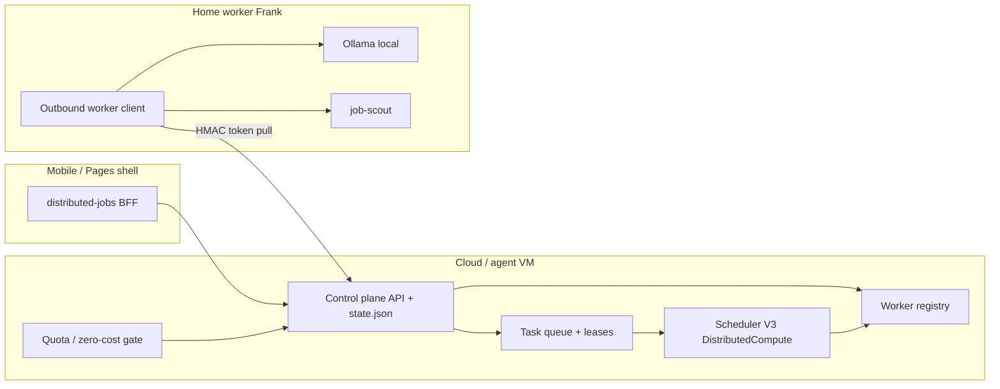

# HYDI distributed cloud — architecture (prototype v1)

Coordinates with GitHub issue #587. **No merge/deploy** until reviewed.

## Goals

1. Heidi control plane stays available when Frank/home workers are offline (durable file/Postgres queue).
2. Freelance discovery and proposal prep can be **scheduled** without home PC liveness.
3. Workloads route to cloud-light or home-trusted workers by capability and resources.

## Data flow

## Reused vs new

| Reused | New in this PR |
|--------|----------------|
| `src/hydi-v3/DistributedCompute.js` scoring | `lib/distributed-cloud/*` control plane |
| `lib/job-scout/scout.js` | `pages/api/heidi-mobile/distributed-jobs.js` |
| `lib/execution-fabric` lease/idempotency patterns | `tests/unit/distributed-cloud-acceptance.test.js` |
| `workers/lib/local-worker-status.js` (concept) | `scripts/distributed-cloud-serve.js` |
| `lib/heidi-mobile/guard.js` | `config/distributed-cloud.json` |

## Worker connection protocol

1. Worker holds `HYDI_DISTRIBUTED_WORKER_SECRET` (or `HYDI_SERVICE_SECRET`).
2. **Outbound** `register` with `Authorization: Bearer <workerId:ts:hmac>`.
3. Periodic `heartbeat` via control plane API (pull).
4. `claimNext` → `startTask` → `completeTask` with optional completion idempotency key.
5. Home never accepts inbound admin/Ollama from the public internet.

## Database / API changes

- **No SQL migrations** in v1 (file persistence under `.runtime/distributed-cloud/`).
- **New API:** `GET /api/heidi-mobile/distributed-jobs` (mobile durable snapshot).
- **Optional:** `node scripts/distributed-cloud-serve.js` on loopback `:3471`.

## Follow-up (approved)

- Postgres task store shared with execution fabric.
- Schedule `freelance.discover` from `scripts/hydi-schedulers.js` via control plane enqueue.
- GitHub Actions dispatcher worker (manual workflow only, zero-cost guards).