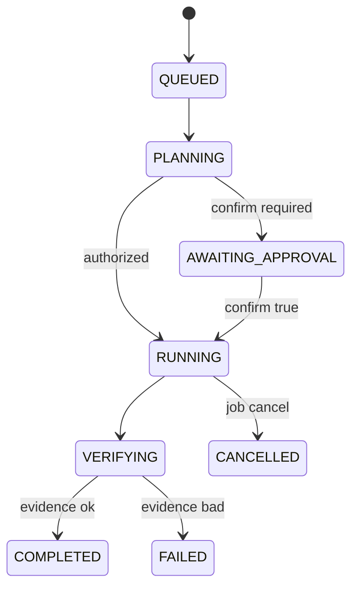

# HYDI Execution Fabric (mobile ops)

Unified **capability registry + task lifecycle + authorization gateway** for
phone-driven operations. It wraps existing mobile-ops typed actions and jobs —
no second shell, queue, or auth system.

## Lifecycle

```text
DISCOVER → PLAN → AUTHORIZE → EXECUTE → VERIFY → CHECKPOINT → LEARN → REPORT
```

Task states (persisted in-process, reconnect-safe via task id):

`QUEUED` → `PLANNING` → (`AWAITING_APPROVAL`) → `RUNNING` → `VERIFYING` → `COMPLETED` | `FAILED` | `CANCELLED`



## API

| Route | Method | Purpose |
|-------|--------|---------|
| `/api/mobile-ops/fabric` | GET | List capabilities (`status:view`) |
| same | GET `?readiness=1` | Fabric readiness (not full HYDI) |
| same | GET `?task_id=` | Task status + steps |
| same | GET `?history=1` | Recent tasks |
| same | POST | `{ capability, args?, confirm?, objective? }` |
| same | POST | `{ task_id, cancel: true }` (job-backed only) |

BFF: `/api/heidi-mobile/fabric` (signed upstream).

**Idempotency:** header `x-idempotency-key` or body `idempotency_key` (24h, in-process).

## Capabilities

Sync (existing typed actions): `health.check`, `service.status`, `git.inspect`, `tests.run`.

Jobs (prefix `job.`): e.g. `job.tests.suite`, `job.walkie.tests` — see `lib/mobile-ops/job-catalog.js`.

Registry: `lib/execution-fabric/capabilities.js`.

## Gap analysis (2026-10-14)

| Area | Existing | Fabric adds |
|------|-----------|-------------|
| Allowlisted ops | `action-catalog`, `typed-actions` | Unified registry + risk metadata |
| Long jobs | `job-manager` (in-memory) | Task record + lifecycle + job link |
| Heidi cognitive registry | `lib/heidi/CapabilityRegistry.ts` | Mobile ops slice (separate tree) |
| Recovery authorizer | `CapabilityAuthorizer.ts` | Not duplicated |
| Persistence | Audit log only | Task store (process-global; restart clears) |

**Not in this slice:** Supabase-backed task persistence, PAUSE/RECOVER for sync ops, automatic code changes from LEARN phase.

## Safe test (hermetic)

```bash
npx jest tests/unit/execution-fabric-gateway.test.js tests/unit/execution-fabric-task-store.test.js --runInBand
```

## Recovery

- **Stale task after heidi-web restart:** task id may be unknown; re-run capability with a new idempotency key.
- **Job still running:** poll `GET ?task_id=`; logs remain on `/api/mobile-ops/jobs?id=&since=`.

See also [MOBILE_OPERATIONS.md](./MOBILE_OPERATIONS.md), [CURSOR_CLOUD_AGENT.md](./CURSOR_CLOUD_AGENT.md).
