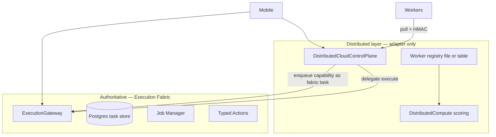

# Execution fabric unification plan (proposal — no migration)

## Problem

Two parallel job models exist today:

| | Execution Fabric | Distributed cloud (PR #590) |
|--|------------------|-----------------------------|
| Store | `MemoryTaskStore` / `PostgresTaskStore` | `DistributedCloudStore` (JSON file) |
| States | QUEUED → RUNNING → COMPLETED (rich FSM) | queued → claimed → running → completed |
| Leases | `claimLease`, `recoverInterruptedTasks` | `reclaimExpiredLeases` |
| Mobile | `pages/api/heidi-mobile/fabric.js` | `distributed-jobs.js` |
| Auth | RBAC + tenant | HMAC worker token |
| Execution | `ExecutionGateway` + typed actions | In-process runners / job-scout |

**Verdict:** Partial duplication — scheduling and registry overlap; execution authority must remain **Execution Fabric only**.

## Target architecture (single lifecycle)

## Phased rollout (requires approval each phase)

1. **Adapter:** Map `distributed-cloud` enqueue → `ExecutionGateway.createTask` for capability IDs already in fabric.
2. **Registry:** Mirror worker heartbeats into `worker_status` table or unify with `workers/lib/local-worker-status.js`.
3. **Postgres:** Single store via `EXECUTION_FABRIC_PERSIST=postgres` after schema audit (transactions, RLS, rollback scripts).
4. **Intelligence:** `HEIDI_INTELLIGENCE_LAYER` router hints feed capability choice, not execution.
5. **Revenue:** #589 `revenue-ops` discovery tasks become fabric capabilities; distributed queue only schedules them.

## Preconditions before Postgres migration

- [ ] Document all state transitions in one enum table
- [ ] Idempotency scope alignment (`mobile-ops` vs `distributed-cloud`)
- [ ] Replay tests from `tests/unit/pipeline-replay.test.js` pattern
- [ ] Governance gate if new migrations added
- [ ] Rollback: keep file store read-only fallback for 30 days