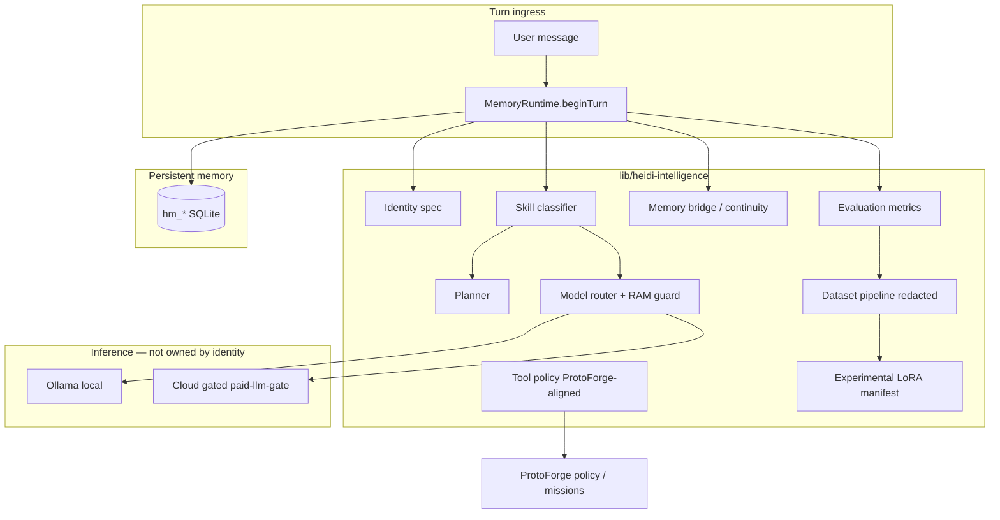

# Heidi Custom Intelligence Layer

Model-independent orchestration for Heidi: identity, memory continuity, planning, routing, skills, ProtoForge-aligned tool policy, human approval boundaries, evaluation, dataset capture, and an isolated fine-tuning pathway.

**Production impact:** Off by default. Enable with `HEIDI_INTELLIGENCE_LAYER=true`. Does not change production model weights or `HEIDI_TOOL_MODEL` without separate operator approval.

## Architecture

## Layer responsibilities

| # | Requirement | Location |
|---|-------------|----------|
| 1 | Canonical identity | `config/heidi-intelligence/identity.json`, `lib/heidi-intelligence/identity.js` |
| 2 | Memory + continuity | Existing `heidi-core/memory/*`; bridge in `memory-bridge.js` |
| 3 | Reasoning / planning | `planner.js` (structured steps, no execution) |
| 4 | Model router | `router.js` + existing `lib/ModelManager.ts` at inference time |
| 5 | Skill profiles | `config/heidi-intelligence/skills.json`, `skills.js` |
| 6 | Tool policy | `tools-policy.js` (fail-closed, escalate consequential) |
| 7 | Human approval | Consequential tools → `escalate`; respects `HEIDI_ALLOW_EXEC` |
| 8 | Task evaluation | `evaluation.js`, `config/heidi-intelligence/evaluation-suite.json` |
| 9 | Dataset pipeline | `dataset-pipeline.js` (capture + redaction gates) |
| 10 | Fine-tune path | `finetune-pathway.js` (experimental flag, manifest only) |

## Environment flags

| Variable | Default | Purpose |
|----------|---------|---------|
| `HEIDI_INTELLIGENCE_LAYER` | off | Master switch for turn envelope |
| `HEIDI_INTELLIGENCE_MIN_FREE_RAM_GB` | 1.5 | Block assuming concurrent large local models |
| `HEIDI_INTELLIGENCE_DATASET_CAPTURE` | off | Append redacted JSONL |
| `HEIDI_DATASET_CLIENT_AUTHORIZED` | off | Required for training capture |
| `HEIDI_FINETUNE_EXPERIMENTAL` | off | Write experimental manifest only |
| `HYDI_ALLOW_PAID_LLM` | off | Cloud route (existing gate) |

## Rollback

1. Unset `HEIDI_INTELLIGENCE_LAYER` (or set false).
2. Remove experimental manifest under `.runtime/heidi-intelligence/experimental/`.
3. Compare new router changes with `npm run test -- tests/unit/heidi-intelligence-layer.test.js` and evaluation harness in `runHarnessSelfTest()`.

## Implementation phases

1. **Shipped in this PR:** Config, library, heidi-core adapter, unit tests, documentation.
2. **Follow-up (approved):** Wire `intelligence.systemOverlay` into heidi-core chat system prompt assembly; feed `route` hints to `ModelManager` selection API.
3. **Follow-up (approved):** Integration tests with live Ollama against `evaluation-suite.json`.
4. **Follow-up (approved):** Export corpus → external LoRA/SFT job; never promote without eval pass rate and operator sign-off.