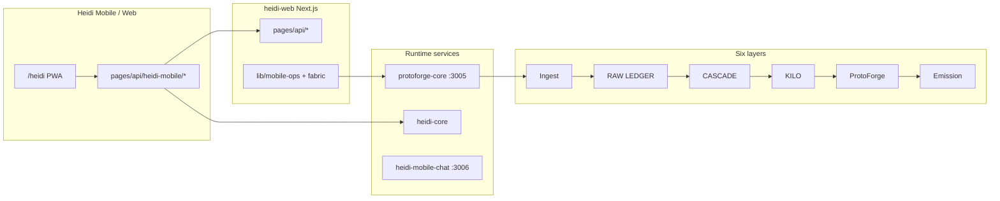

# HYDI master architecture map (live audit)

**Audit issue:** [#587](https://github.com/waveformer1984/HYDI-System-v2/issues/587)  
**Observed `clean-main`:** `6d80c5874586a669e055bd41c0897327065097ef` (2026-11-15 UTC)  
**Evidence source:** repository inspection + Cursor Cloud Agent VM probes (not Frank/Android).

## Six-layer pipeline (authoritative contract)

```text
[1] Ingestion        → structure only (adapters, schema lock)
[2] RAW LEDGER     → append-only, hashed (protoforge/hydi-gateway)
[3] CASCADE        → classify only (CascadeClassificationV2)
[4] KILO           → hypotheses only — execute() throws
[5] ProtoForge     → policy gate (lib/protoforge/policy-engine.js)
[6] Emission       → SSE / API / logs — no business logic
```

**Composer:** `lib/pipeline` (`createPipeline().run()`).  
**Live entry (protoforge-core):** `modules/cascade-complete-v2.js` → `processEvent()` → `this.pipeline.run()` (verified in source 2026-11-15).



## Service inventory (repository-defined)

| Component | Entry / port (docs) | Role |
|-----------|----------------------|------|
| heidi-web | `next` :3000 | Dashboard, `/heidi`, BFF, mobile-status |
| protoforge-core | :3005 | CASCADE + full pipeline, `/cascade/event` |
| heidi-mobile-chat | :3006 | Phone chat surface (PM2) |
| heidi-core | `heidi-core/server.js` | Missions, chat-tools, system status |
| hydi-daemon | PM2 | Unattended resolver loop |
| workers/* | WorkerOrchestrator | Queue pollers |
| Supabase | :54321 local / cloud | Postgres + Edge Functions (Deno) |
| Ursula suite | External Python :5000 | Separate host (Frank) |

## Mobile operational path (verified design)

| Step | Mechanism |
|------|-----------|
| UI | `pages/heidi.tsx` → `components/heidi-mobile/*` |
| Session | `pages/api/heidi-mobile/session.js` (sealed cookie, pairing) |
| Guards | `lib/heidi-mobile/guard.js` |
| Typed ops | `pages/api/heidi-mobile/ops.js` ← `lib/mobile-ops/action-catalog.js` |
| Fabric | `pages/api/heidi-mobile/fabric.js` (capabilities, idempotency) |
| Credentials | Server-side `HYDI_SERVICE_SECRET` / device HMAC — never in browser bundle (enforced by `tests/unit/heidi-mobile-security.test.js`) |

## Security boundaries

- **KILO:** no execution (`kilo/index.js` `execute()` throws).
- **ProtoForge:** fail-closed default `reject`.
- **Public ingress:** `proxy.ts` → `lib/security/ingressGate.js`.
- **Emission:** no added logic in layer 6.

## What this document is not

Not a substitute for `CLAUDE.md`, `HEIDI_V2_ARCHITECTURE.md`, or operational runbooks on Frank. Operational truth requires host-local probes (PM2, disk, Tailscale) — **blocked for this agent without Frank approval**.