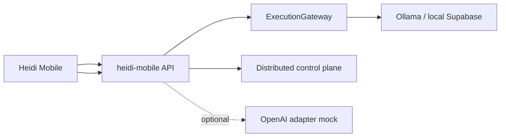

# HYDI OpenAI partnership technical demo

**Classification default:** VERIFIED SIMULATED (no paid API).  
**Never** label mock inference or simulated workers as live production.

## Demo storyline (10 steps)

1. **Heidi Mobile** — static shell or local `/heidi` (pairing optional)  
2. **System status** — `mobileSnapshot` / distributed jobs (PR #590 branch)  
3. **Agent registration** — `DevWorkforceRegistry.register()`  
4. **Task assignment** — `DevWorkforceCoordinator.assign({ capabilityId: 'health.check' })`  
5. **Distributed queue** — enqueue lightweight task (PR #590)  
6. **Worker auth** — v2 HMAC token (simulated worker)  
7. **Approval gate** — enqueue `freelance.submit_proposal` → awaiting approval  
8. **Execution evidence** — fabric task row + `execution_authority` field  
9. **Provider selection** — `capability()` shows `mock` OpenAI mode  
10. **Revenue read-only** — job-scout fixtures (acceptance tests)

## Architecture diagram



## Run instructions (simulated)

```bash
# Master mission branch
npx jest tests/unit/openai-adapter.test.js tests/unit/dev-workforce-coordinator.test.js --runInBand

# PR #590 branch
npx jest tests/unit/distributed-cloud-acceptance.test.js --runInBand
node scripts/distributed-live-smoke.js
```

## Feature matrix

| Feature | Demo evidence | Classification |
|---------|---------------|----------------|
| Pipeline six layers | Docs + unit replay tests | VERIFIED SIMULATED |
| Fabric execution | dev-workforce test | VERIFIED SIMULATED |
| Distributed hardening | PR #590 jest | VERIFIED SIMULATED |
| OpenAI live call | Not run | REQUIRES OPERATOR APPROVAL |
| Frank worker | Not run | BLOCKED |

## Short introduction (elevator pitch)

HYDI is an approval-gated AI operations platform: mobile-first control, deterministic pipelines, and a single execution gateway — designed to run at **zero API cost** locally while scaling to cloud workers when operators opt in.