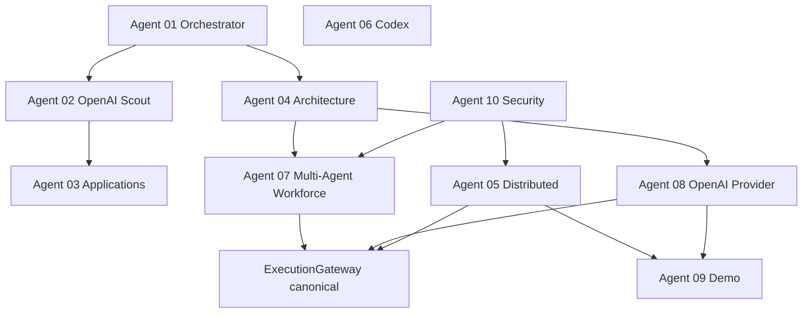

# HYDI OpenAI Master Mission — Mission Control

**Repository:** [waveformer1984/HYDI-System-v2](https://github.com/waveformer1984/HYDI-System-v2)  
**Primary branch:** `clean-main`  
**Distributed track:** [PR #590](https://github.com/waveformer1984/HYDI-System-v2/pull/590) · [#587](https://github.com/waveformer1984/HYDI-System-v2/issues/587)  
**Master mission branch:** `Cusor_agent01openai-master-mission-7718`  
**Orchestrator:** Agent 01 (Executive)  
**Last updated:** 2026-11-15 UTC

## Dependency graph



**Conflict rules**

| Path / branch | Owner | Do not touch without merge plan |
|---------------|-------|----------------------------------|
| `lib/distributed-cloud/*` | Agent 05 · PR #590 | Master mission branch |
| `lib/execution-fabric/*` | Agent 04/05 | Large gateway edits |
| `lib/cost/paid-llm-gate.js` | Agent 08 | Any weakening of $0 default |
| `.runtime/state.json` | Operator | All agents |
| `frontend/next-env.d.ts` | Build | All agents |

## Agent roster and status

| ID | Role | Primary deliverable | Branch | Status | Classification |
|----|------|---------------------|--------|--------|----------------|
| 01 | Executive Orchestrator | This document | `Cusor_agent01openai-master-mission-7718` | **COMPLETE** | VERIFIED SIMULATED |
| 02 | OpenAI Partnership Scout | `OPENAI_RESOURCE_OPPORTUNITIES.md` | same | **COMPLETE** | VERIFIED LIVE (URLs cited) |
| 03 | Application Engineer | `OPENAI_PARTNERSHIP_APPLICATIONS.md` | same | **COMPLETE** | REQUIRES OPERATOR APPROVAL (submit) |
| 04 | Architecture Engineer | `HYDI_MASTER_ARCHITECTURE_AUDIT.md` | same | **COMPLETE** | VERIFIED SIMULATED |
| 05 | Distributed Computing | Phase 2 hardening | PR #590 | **COMPLETE** (prior turn) | VERIFIED SIMULATED |
| 06 | Codex Integration | `HYDI_CODEX_INTEGRATION.md` | master mission | **COMPLETE** | CONFIGURED BUT UNTESTED |
| 07 | Multi-Agent Workforce | `HYDI_MULTI_AGENT_WORKFORCE.md` + `lib/dev-workforce/*` | master mission | **PARTIAL** | VERIFIED SIMULATED (unit tests) |
| 08 | OpenAI Model Integration | `HYDI_OPENAI_PROVIDER_INTEGRATION.md` + adapter | master mission | **PARTIAL** | VERIFIED SIMULATED (mock) |
| 09 | Demonstration | `HYDI_OPENAI_DEMO.md` | master mission | **COMPLETE** | VERIFIED SIMULATED |
| 10 | Security & Governance | `HYDI_AGENT_SECURITY_GOVERNANCE.md` | master mission | **COMPLETE** | VERIFIED SIMULATED |

## Work ownership (commits)

| Commit (branch) | Scope |
|-----------------|--------|
| `6cff0bb5` | PR #590 — distributed concurrency + HMAC replay |
| `9ceaf3ee` | Master mission — docs + `lib/providers/openai-adapter.js` + `lib/dev-workforce/*` |

## Integration checklist

- [x] Distributed vulns addressed on PR #590 (same-host lock, JTI replay)
- [x] OpenAI opportunities documented from official sources only
- [x] Application pack drafted (not submitted)
- [x] Mock OpenAI adapter behind `paid-llm-gate`
- [x] Dev workforce coordinator → `ExecutionGateway.submit` (no second engine)
- [ ] Live OpenAI API call | **BLOCKED** (`HYDI_ALLOW_PAID_LLM` off by policy)
- [ ] Frank worker | **BLOCKED** (tailnet from cloud VM)
- [ ] GHA distributed worker | **CONFIGURED BUT UNTESTED** (PR #590 workflow)

## Verification commands

```bash
# Master mission branch
npx jest tests/unit/openai-adapter.test.js tests/unit/dev-workforce-coordinator.test.js tests/unit/hydi-openai-mission-acceptance.test.js --runInBand

# PR #590 distributed (checkout prototype branch)
npx jest tests/unit/distributed-cloud*.test.js --runInBand --forceExit
```

## Operator actions required

1. Review and submit OpenAI applications (`OPENAI_PARTNERSHIP_APPLICATIONS.md`) — **REQUIRES OPERATOR APPROVAL**
2. Set `HYDI_ALLOW_PAID_LLM=true` only when credits approved — **REQUIRES OPERATOR APPROVAL**
3. Dispatch GHA distributed worker once with secrets — **CONFIGURED BUT UNTESTED**
4. Frank live worker validation — **BLOCKED** until tailnet access from operator host

## Evidence

Machine-readable: `/opt/cursor/artifacts/hydi-openai-master-mission-evidence.json`