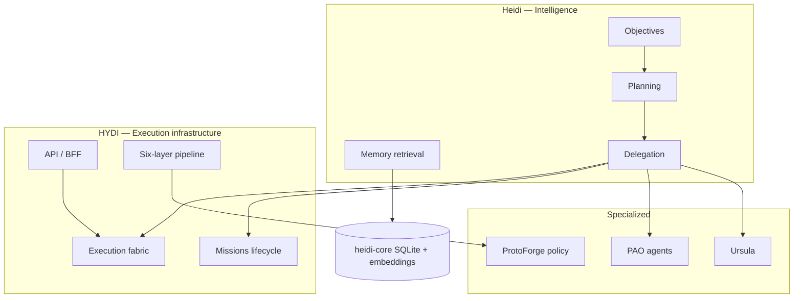

# Heidi autonomous operating system (target architecture)

**Status:** TARGET — evolved from existing HYDI v2; do not replace working paths.

This document **indexes** authoritative implementation docs. Prefer updating linked files over copying content here.

---

## Layer model

## Responsibility matrix

| Layer | Canonical doc | Code anchors |
|-------|---------------|--------------|
| Heidi intelligence | `HEIDI_PERSISTENT_MEMORY.md`, `HEIDI_TASK_LIFECYCLE.md` | `heidi-core/`, `lib/heidi/CognitiveCore.ts` |
| HYDI execution | `EXECUTION_FABRIC_UNIFICATION_PLAN.md` | `lib/execution-fabric/`, `workers/` |
| ProtoForge | `CLAUDE.md` pipeline § | `lib/protoforge/`, protoforge-core |
| Ursula | `CLAUDE.md` Ursula suite | External Python; Flask localhost |
| Mobile | `HEIDI_MOBILE.md` | `pages/api/heidi-mobile/*` |
| Governance | `HEIDI_APEX_AUTONOMY_BOUNDARY.md`, `GOVERNANCE.md` | bounds, missions, paid-llm gate |

## Execution lifecycle (required)

States: `QUEUED → PLANNING → AWAITING_APPROVAL → RUNNING → VERIFYING → COMPLETED` (+ `FAILED`, `CANCELLED`).

**Implemented:** `heidi-core/missions/lifecycle.js` — extend, do not fork.

**Unification needed:** `lib/mobile-ops/` job IDs + distributed-cloud queues → single evidence model (`docs/EXECUTION_FABRIC_UNIFICATION_PLAN.md`).

## Memory (five layers — mapping)

| Layer | Current store | Gap |
|-------|---------------|-----|
| Working | Session + mission context | Mobile sync |
| Episodic | `hm_*` turns, `mission_events` | Provenance UI |
| Semantic | Embeddings / Supabase `memories` | Contradiction detection |
| Procedural | Missions + fix-list templates | Learning loop |
| Strategic | Human actions / goals APIs | Long-horizon tracking |

Detail: `docs/architecture/HEIDI_MEMORY_ARCHITECTURE.md` (stub).

## Model routing

- Default: local Ollama (`HYDI_ALLOW_PAID_LLM` off).
- Experimental: NCM + intelligence router (`docs/NCM_EXPERIMENTAL_INTEGRATION.md`).
- Target: one opt-in dispatch boundary — **not yet enforced**.

## Security

- High-risk: financial, external submit, prod deploy → human approval only.
- Evidence: `heidi_events`, mission events, `action_refused` rows.

## Roadmap

`docs/roadmaps/HEIDI_90_DAY_EVOLUTION.md`

## Audit baseline

`docs/reports/HEIDI_FULL_ECOSYSTEM_AUDIT.md`