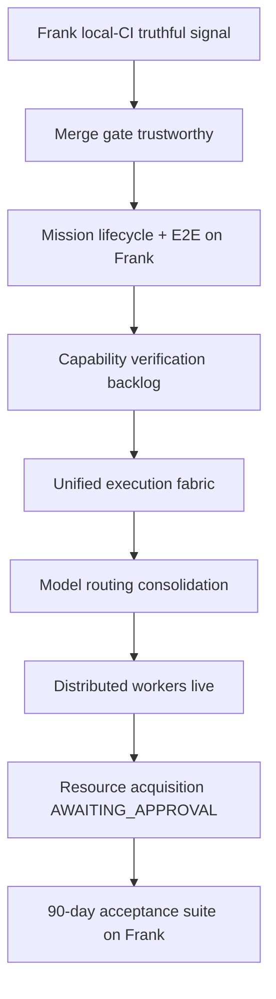

# HEIDI full ecosystem audit (read-only baseline)

**STATUS:** BASELINE COMPLETE (cloud VM, `clean-main` `c881f0c`)  
**Mission:** Master directive — FULL SYSTEM EVOLUTION, Part I  
**Not verified on Frank/heidi-pc** unless noted.

---

## 1. Repository baseline

| Item | Value |
|------|--------|
| Repository | `waveformer1984/HYDI-System-v2` |
| Primary branch | `clean-main` |
| Baseline SHA | `c881f0c10b5b0f657a236e97dccba67dfc54a096` |
| Cloud audit date | 2026-11-15 |
| Node (cloud) | v22.23.4 |
| Agent branch (local-CI fix) | `Cusor_agent01frank-local-ci-eslint-env-7718` |

**Working tree (audit agent):** isolated branch; local-CI infrastructure edits only on that branch. NCM work remains on `Cusor_agent01ncm-experimental-7718` (PR #599, `ff21b57f`).

---

## 2. What is operational (hermetic / CI-verified)

| Subsystem | Entry / evidence | Live Frank |
|-----------|------------------|------------|
| Six-layer pipeline | `lib/pipeline/`, protoforge-core :3005 | **Unverified** from cloud |
| Mission lifecycle | `heidi-core/missions/lifecycle.js`, `HEIDI_TASK_LIFECYCLE.md` | **Partial** (design + SQLite) |
| Persistent chat memory | `heidi-core/data/heidi_memory.db`, `HEIDI_PERSISTENT_MEMORY.md` | **Unverified** |
| Health truth API | `heidi-core/status/system-status.js`, `system report` | **Unverified** |
| Mobile BFF | `pages/api/heidi-mobile/*`, `HEIDI_MOBILE.md` | **Unverified** |
| Paid LLM gate | `lib/cost/paid-llm-gate.js`, `HYDI_ALLOW_PAID_LLM` default off | **Verified** on agent VM |
| GitHub Actions CI | `unit-tests.yml`, `integration-tests.yml` | **Green** on recent heads (when billing allows) |
| Local CI (Frank) | `scripts/local-ci.js`, PM2 `hydi-local-ci` | **RED lint** — root cause identified (see `frank-windows-local-ci-root-cause.md`) |
| Resource acquisition modules | `lib/resource-acquisition/*` | **Simulated / partial** in tests |
| Distributed cloud control plane | `lib/distributed-cloud/*`, acceptance tests `[SIMULATED]` | **No live Frank worker** |
| NCM experimental | `lib/inference/*`, PR #599 | **Off by default**; GHA green |

---

## 3. Partially implemented (needs integration)

| Area | Exists | Gap |
|------|--------|-----|
| **Execution fabric** | `lib/mobile-ops/`, `EXECUTION_FABRIC_UNIFICATION_PLAN.md` | Unified job ID / mobile-ops vs distributed idempotency |
| **Capability contracts** | `CapabilityRegistry` (77 descriptors), `capability-contract-audit.ts` | 77× verification absent; 19× no undo |
| **Model routing** | `inference-route.js`, NCM router (experimental), `ModelManager` | No single enforced router in production chat path |
| **Ops snapshot** | `GET /operations/snapshot`, operations evidence | No unified mobile ops dashboard |
| **Cognitive unattended loop** | `hydi-daemon`, `CognitiveCore`, `heidi_decision_bounds` | Frank E2E not proven from cloud |
| **ProtoForge as dev engine** | MCP `protoforge`, Cursor agents, local-ci | Not wired to mission lifecycle for auto-PR |
| **Ursula** | Separate Python suite (local), checkpoint | Not unified into Heidi delegation graph |
| **Revenue / Stripe** | Connect + billing module | Operational boundary / test-mode filters exist; live revenue **unverified** |

---

## 4. Simulated vs live (honest labels)

| Claimed in tests/docs | Mode | Notes |
|----------------------|------|-------|
| Distributed acceptance | `[SIMULATED]` | `tests/unit/distributed-cloud-acceptance.test.js` |
| Operational autonomy acceptance | Simulated degrade/repair | No Frank collector output in cloud |
| Resource acquisition dispatch | Registry executors stubbed | `heidi-executors.js` partial |
| Cloud agent → Frank MCP | **BLOCKED** | No tailnet on default cloud VM |
| Mobile token hardening | Code present | `HEIDI_MOBILE_TOKEN` enforcement depends on env |
| KILO execution | **Throws by design** | Hypotheses only — correct |

---

## 5. Duplication / boundary risks

- **Two CapabilityRegistry concepts:** `lib/heidi/CapabilityRegistry.ts` vs V3 copy — consumers must use correct import (documented in TS file).
- **Multiple chat paths:** `heidi-core`, Next `api/chat`, mobile relay — memory sync via shared contracts, not one process.
- **CI signals:** GitHub Actions + Frank `local-ci/*` — Frank lint failure was infra, not duplicate test logic.
- **Many agent branches / PRs** — see §7; risk of conflicting autonomy features.

---

## 6. Security and governance (snapshot)

- Fail-closed PolicyEngine default `reject` — **must not change**.
- Pipeline layer boundaries — enforced in `.cursorrules` / `AGENTS.md`.
- Ingress gate for public tunnels — `lib/security/ingressGate.js`.
- Operator lease + decision evidence — Postgres tables, fail-soft writes.
- **Cloud agent cannot** reach Frank production without Tailscale / tokens (`docs/CURSOR_CLOUD_AGENT.md`).

---

## 7. Open PR / branch inventory (sample)

Cloud agent has registered multiple `Cusor_agent01*-7718` branches (NCM, autonomy phase 2, mobile fabric, Frank host, resource acquisition, etc.). **Do not merge in parallel without stacking review** — prefer one infrastructure PR (local-CI) then feature PRs.

Notable:

- **PR #599** — NCM experimental (`ff21b57f`): GHA green; Frank local-ci lint red (host-wide, pre-NCM).

---

## 8. CI status (2026-11-15)

| Check | `ff21b57f` / PR #599 | `c881f0c` clean-main |
|-------|----------------------|----------------------|
| GHA unit + integration | Pass | Pass (typical) |
| Codecov patch (#599) | 84.44% | — |
| Frank `local-ci/typecheck` | Pass | Pass |
| Frank `local-ci` lint gates | Fail | Fail |

---

## 9. Implementation dependency graph (Phase 1 foundations)

**Immediate unblock:** local-CI ESLint env sanitization + Frank operator verify.

**Parallel read-only:** ecosystem docs under `docs/architecture/` (this audit feeds them).

---

## 10. Highest-impact gaps (prioritized)

1. **Frank production truth** — run `scripts/frank-production-truth-collect.ps1`; upload JSON to cloud agents.
2. **local-CI lint false negative** — infrastructure fix ready; Frank re-run.
3. **RAM pressure on Frank** — documented in CLAUDE.md; needs measured plan (Phase 1 roadmap).
4. **Capability verification** — 77 contracts without verification hooks.
5. **Single execution job model** — align `mobile-ops` + missions + distributed-cloud.
6. **Mobile operational client** — APIs exist; unified command center UI incomplete.
7. **NCM** — experimental until benchmark gates in `NCM_EXPERIMENTAL_INTEGRATION.md`.

---

## 11. Related documents (do not duplicate)

| Doc | Role |
|-----|------|
| `CLAUDE.md` | Canonical ops / architecture |
| `docs/HEIDI_TASK_LIFECYCLE.md` | Mission state machine |
| `docs/HEIDI_OPERATIONAL_AUTONOMY_MISSION_REPORT.md` | Prior autonomy audit |
| `docs/HYDI_MASTER_ARCHITECTURE_AUDIT.md` | Earlier master audit |
| `docs/EXECUTION_FABRIC_UNIFICATION_PLAN.md` | Execution merge plan |
| `docs/reports/frank-windows-local-ci-root-cause.md` | Frank lint CI |

---

## 12. Acceptance

This audit satisfies **Part I baseline** for the master directive. **Next implementation workstreams:** H (reliability — local-CI PR), then B (execution fabric) per `docs/roadmaps/HEIDI_90_DAY_EVOLUTION.md`.